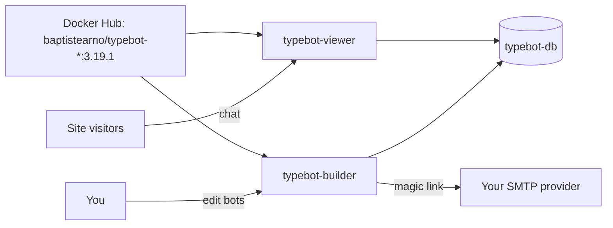

<div align="center">

# Typebot on Render

Build chatbots visually, embed them anywhere, and keep the data in your own database. This repo is the Blueprint. The app runs from the official [Typebot](https://github.com/baptisteArno/typebot.io) Docker images.

<p>
  <a href="https://render.com/deploy-template/api/github/start?template_repo=typebot">
    
  </a>
</p>

<p>
  <a href="https://render.com">
    
  </a>
  <a href="https://github.com/baptisteArno/typebot.io">
    
  </a>
  <a href="https://github.com/baptisteArno/typebot.io/blob/main/LICENSE">
    
  </a>
</p>

</div>

## What This Template Shows

This repository does not contain the Typebot source. Both services pull the official images from Docker Hub at a pinned version. To upgrade, change the tag in [`render.yaml`](./render.yaml) and push. The Blueprint redeploys both services.

| Piece | Role |
| --- | --- |
| **[Typebot](https://github.com/baptisteArno/typebot.io)** | Visual chatbot builder with a chat API, embeds, webhooks, and OpenAI, Sheets, and Zapier blocks. |
| **`typebot-builder`** ([Web Service](https://render.com/docs/web-services)) | Editor, dashboard, and API. Runs database migrations on boot. |
| **`typebot-viewer`** ([Web Service](https://render.com/docs/web-services)) | Serves published bots and the chat API that embeds call. |
| **`typebot-db`** ([Render Postgres](https://render.com/docs/postgresql)) | Bots, results, users, and encrypted credentials. |

## Architecture



### How It Works

1. Click **Deploy to Render**. The flow copies this repo into your GitHub account and applies [`render.yaml`](./render.yaml).
2. On Apply, fill in `ADMIN_EMAIL` and your SMTP settings. Render creates the database, generates the encryption key, and wires each service's public URL into the other.
3. The builder runs `prisma migrate deploy`, then starts. The viewer starts beside it.
4. Open the `typebot-builder` URL, enter `ADMIN_EMAIL`, and click the sign-in link in your inbox. That account gets an unlimited workspace.

| Resource | Type | Plan | Notes |
| --- | --- | --- | --- |
| `typebot-builder` | Web, image | Starter | `baptistearno/typebot-builder:3.19.1` |
| `typebot-viewer` | Web, image | Starter | `baptistearno/typebot-viewer:3.19.1` |
| `typebot-db` | Postgres 16 | Basic 256 MB | Internal connections only. |

Default region: **Oregon**.

## Quick Start

### Prerequisites

- A [Render account](https://dashboard.render.com/register)
- SMTP credentials for sign-in emails. Any provider works, for example [Resend](https://resend.com/docs/send-with-smtp), Postmark, SendGrid, or Amazon SES.

### Deploy

1. Click **Deploy to Render** above.
2. Fill in `ADMIN_EMAIL`, `SMTP_HOST`, `SMTP_USERNAME`, `SMTP_PASSWORD`, and `NEXT_PUBLIC_SMTP_FROM`.
3. Wait until `typebot-builder` and `typebot-viewer` are **Live**.
4. Open the builder URL and sign in with `ADMIN_EMAIL`.
5. Optional: set `DISABLE_SIGNUP=true` on `typebot-builder` so only invited users can join.

## Configuration

| Variable | Service | Source | Description |
| --- | --- | --- | --- |
| `ADMIN_EMAIL` | builder | Required | Gets an unlimited workspace. Comma-separate several. |
| `SMTP_HOST`, `SMTP_USERNAME`, `SMTP_PASSWORD` | builder | Required | Sends sign-in links and notifications. |
| `NEXT_PUBLIC_SMTP_FROM` | builder | Required | Sender, e.g. `'Typebot' <typebot@example.com>`. |
| `SMTP_PORT` | builder | Blueprint | `587`. Use `465` with `SMTP_SECURE=true`. |
| `DATABASE_URL` | both | Wired | Internal URL of `typebot-db`. |
| `ENCRYPTION_SEED` | both | Generated | Shared random value. Each service exports its first 32 characters as `ENCRYPTION_SECRET`. Do not change it after you save credentials. |
| `NEXTAUTH_URL` | both | Wired | Builder `RENDER_EXTERNAL_URL`. |
| `NEXT_PUBLIC_VIEWER_URL` | both | Wired | Viewer `RENDER_EXTERNAL_URL`. |
| `DISABLE_SIGNUP` | builder | Optional | `true` blocks new sign-ups. Invited users can still join. |
| `GITHUB_CLIENT_ID`, `GOOGLE_AUTH_CLIENT_ID`, … | builder | Optional | Other sign-in providers. See the [upstream configuration](https://docs.typebot.io/self-hosting/configuration). |
| `S3_*` | both | Optional | File uploads in bots and media in the editor. |
| `REDIS_URL` | both | Optional | Turns on rate limiting. Point it at a [Render Key Value](https://render.com/docs/key-value) instance. |

### Why `ENCRYPTION_SEED`

Typebot requires `ENCRYPTION_SECRET` to be exactly 32 characters, and the builder and viewer must share it. Render's `generateValue` returns a longer string. The Blueprint generates `ENCRYPTION_SEED` once on the builder, copies it to the viewer, and each service's start command exports the first 32 characters before it runs the upstream entrypoint.

## Cost

Prices from [Render's pricing page](https://render.com/pricing).

| Resource | Approx. monthly |
| --- | ---: |
| `typebot-builder` (Starter) | $7 |
| `typebot-viewer` (Starter) | $7 |
| `typebot-db` (Basic 256 MB) | $6 |
| **Total** | **~$20** |

## Troubleshooting

| Problem | Solution |
| --- | --- |
| No sign-in email arrives | Check the SMTP values on `typebot-builder` and its logs. Set `TYPEBOT_DEBUG=true` for more detail. |
| `ENCRYPTION_SECRET` validation error on boot | `ENCRYPTION_SEED` is missing or shorter than 32 characters. Check it on both services. |
| Bots fail with credential errors after you rotated the key | Credentials are encrypted with the old key. Restore the old `ENCRYPTION_SEED` or re-add the credentials. |
| Published bot links point at the wrong host | `NEXT_PUBLIC_VIEWER_URL` must be the viewer's public URL. Update it after you add a custom domain, on both services. |
| OOM restarts on the builder | Move `typebot-builder` to Standard. |

## Project Structure

```
render.yaml       Blueprint. Two image-backed web services and Postgres.
README.md         This file
LICENSE           Wrapper license
.env.example      Values the deploy form asks for, and optional extras
```

## Learn More

- [Blueprint spec](https://render.com/docs/blueprint-spec)
- [Typebot self-hosting docs](https://docs.typebot.io/self-hosting/get-started)
- [Typebot configuration](https://docs.typebot.io/self-hosting/configuration)

## License

[MIT](LICENSE) for this wrapper.

Typebot is licensed under the [Functional Source License, Version 1.1, Apache 2.0 Future License](https://github.com/baptisteArno/typebot.io/blob/main/LICENSE). You can self-host it for your own use. You cannot offer it to others as a commercial product that competes with Typebot. Each release converts to Apache 2.0 two years after it ships.
